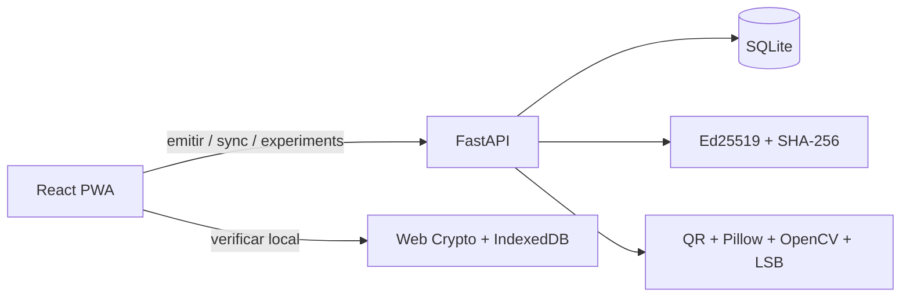

# Architecture

El payload canonico se ordena recursivamente y se firma como UTF-8. El sobre QR contiene payload, firma y public key. La private key se genera una vez en backend/data y nunca se entrega al cliente. SQLite contiene solo payload canonico, hash, firma y metadatos de operacion.
